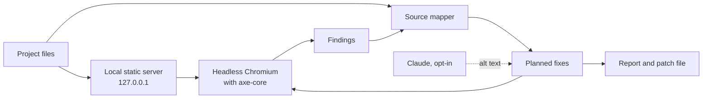

# Data flow

Version 1, 2026-10-11. Describes what allymend does today; planned parts are marked.

## Local scan and fix (the default)

1. Allymend serves the project's files on a random port bound to `127.0.0.1`.
2. Headless Chromium loads each page. axe-core runs inside the page and returns its results to allymend.
3. Allymend reads the project's source files to find where each problem comes from.
4. Each planned fix is checked by loading the page twice in the browser, as it is and with the fix. The fixed page is handed to the browser directly, so nothing is written to disk.
5. Reports and patch files are written where the user asks. The project's own files are never changed.

Allymend itself sends nothing over the network in this mode. The pages it loads can still fetch their own resources, such as fonts or scripts from a CDN, just as they would in a normal browser.

## Alt text from Claude (opt-in)

Only with `allymend fix --text-from claude`, and only for images whose source allymend can patch:

- **What is sent:** the image as the browser decoded it, scaled to at most 1568 pixels (or a screenshot when the page can't read the image back), and the text around it. That is the page title, the nearest heading, a caption, the link the image is in and its text, the file name and nearby text, each cut to 200 characters.
- **Where to:** Anthropic's API, with the user's own credentials, one request per image.
- **Seeing it first:** `--show-payload` prints every request and sends nothing.
- **What comes back:** a short alt text, whether the image looks decorative, and one sentence of reasoning. It is checked, escaped, verified in the browser and listed for a person to review.

## What gets stored

- Reports contain findings, rule IDs, WCAG references and source locations.
- Page content, such as element markup, is left out unless the user asks for it.
- Evidence files contain the checks, the fixes and the text a model wrote, but not the files' full text or the images.
- Credentials are read from the environment by the provider's SDK and never written to reports or logs.

## Network access

| When | What | Where to |
|---|---|---|
| Installation | Python packages and a Chromium build | PyPI and Playwright's download servers |
| URL scans | Requests to the pages given | Those pages only, with an identifying user agent |
| `--text-from claude` | One image and its surrounding text per request | Anthropic's API |
| Polite crawling (planned) | Requests to a whole site | That site, with a rate limit, robots.txt respected and a page cap |

There's no telemetry.
