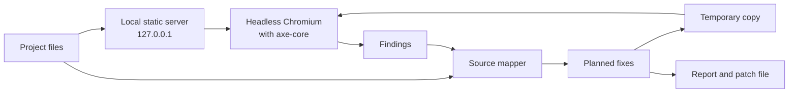

# Data flow

Version 0, 2026-10-10. This describes the design; most of it isn't built yet.

## Local scan (the default)

1. Allymend serves the project's files on a random port bound to `127.0.0.1`.
2. Headless Chromium loads each page. axe-core runs inside the page and returns its results to allymend.
3. Allymend reads the project's source files to find where each problem comes from.
4. Fixes are applied to a temporary copy of the project, which is served and scanned again to check them. The copy is deleted afterwards.
5. Reports and patch files are written where the user asks.

Allymend itself sends nothing over the network in this mode. The pages it loads can still fetch their own resources, such as fonts or scripts from a CDN, just as they would in a normal browser.

## What gets stored

- Reports contain findings, rule IDs, WCAG references and source locations.
- Page content, such as element markup, is left out unless the user asks for it.
- Credentials for scanning authenticated pages are referenced by name (for example an environment variable) and never written to reports or logs.

## Network access

| When | What | Where to |
|---|---|---|
| Installation | Python packages and a Chromium build | PyPI and Playwright's download servers |
| URL scan mode (planned) | Requests to the site being scanned | That site only, with a rate limit, robots.txt respected, an identifying user agent and a page cap |
| Language model help (planned, opt-in) | The minimum needed for one value, for example an image for alt text | The provider the user configures, or a local model |

There's no telemetry.
